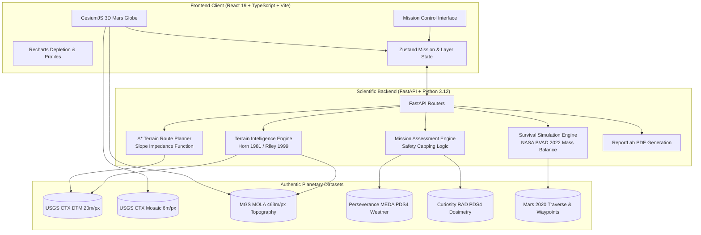

# MARSENSE — The Martian Survival Navigator
### NASA Space Apps Challenge Submission

[](https://www.python.org/)
[](https://fastapi.tiangolo.com/)
[](https://react.dev/)
[](https://www.typescriptlang.org/)
[](https://cesium.com/)
[]()
[](LICENSE)

> **"Can astronauts safely explore a selected region of Mars, achieve their scientific objectives, manage their life-support resources, and return safely?"**

MARSENSE is an end-to-end mission planning, geospatial terrain analysis, and astronaut survival navigation platform engineered for human surface exploration of Mars. Centered on **Jezero Crater (18.38°N, 77.58°E)** — the landing site of NASA's Mars 2020 *Perseverance* rover — MARSENSE fuses authentic NASA/USGS orbital rasters, in-situ planetary science data, terrain-aware pathfinding algorithms, and physiological mass-balance life-support simulations into a unified NASA Mission Control interface.

---

## 🌟 Key Capabilities

### 1. 3D Martian Planetary Explorer (`/explorer`)
- **CesiumJS 3D Mars Globe** running the IAU Mars 2000 ellipsoid and MGS MOLA elevation topography.
- High-resolution **USGS CTX 6 m/px orthomosaic** and **20 m/px Digital Terrain Model (DTM)** overlays.
- Multi-spectral terrain layers: Horn slope heatmaps, Riley Terrain Ruggedness Index (TRI) roughness, and Perseverance ground tracks.
- Coordinate-accurate click-to-inspect engine reporting elevation, slope grade, surface roughness, and traversability metrics.

### 2. Terrain Intelligence Engine (`/terrain`)
- Real-time finite-difference calculations implementing **Horn (1981)** slope vectors and **Riley et al. (1999)** roughness matrices.
- Geomorphic classification distinguishing flat basins, gentle rolling plains, moderate grades, steep scarps, and impassable cliff faces.
- Automated Traversability Index ($0-100$) calibrated to crewed pressurized rover mechanical climbing thresholds.

### 3. Landing & Base-Site Decision Matrix (`/landing`)
- Multi-criteria decision analysis comparing candidate exploration bases (*Octavia E. Butler*, *Delta Scarp Base*, *Neretva Vallis Rim*).
- Interactive factor weight tuning for slope safety, surface roughness, scientific accessibility, landing delta-V, and trafficability.

### 4. Planetary Science Discovery Catalogue (`/science`)
- Curated database of peer-reviewed Jezero geological formations from the Mars 2020 mission team (*Kodiak Butte*, *Delta Scarp*, *Séítah*, *Belva Crater*, etc.).
- Unit filtering, priority ratings, and one-click routing targets for scientific expedition planning.

### 5. Water & Mineral Resource Intelligence (`/resources`)
- CRISM, PIXL, and SHERLOC aqueous mineralogy detections (smectite clays, Fe/Mg carbonates, hydrated silica).
- **Scientific Honesty Guarantee:** Prominent disclosures clarifying that equatorial Jezero contains no detectable near-surface water ice, detailing thermal pyrolysis ISRU requirements ($400^\circ\text{C}-800^\circ\text{C}$).

### 6. Atmospheric & Radiation Environment (`/environment`)
- Direct diurnal temperature and surface atmospheric pressure records from the **Perseverance MEDA** PDS4 dataset (11 sols).
- Galactic Cosmic Ray (GCR) background dosimetry from **Curiosity RAD** at Gale Crater ($210\ \mu\text{Gy/sol}$) with cumulative expedition dosage projections.

### 7. Terrain-Aware Mission Route Planner (`/routes`)
- 8-connected grid **A\* pathfinding** operating on 20-meter DTM rasters.
- Three specialized routing strategies:
  - **Shortest Distance:** Minimal Euclidean travel distance.
  - **Balanced:** Optimal trade-off between traverse distance and topographical energy expenditure.
  - **Lowest Risk:** Exponential hazard penalty avoiding slopes $>15^\circ$ and boulder-strewn terrain.
- Dynamic elevation profile visualization, hazard segment identification, and DTM verification boundaries.

### 8. Astronaut Survival Simulator (`/survival`)
- Hourly mass-balance metabolic simulation calibrated to **NASA BVAD 2022** (Baseline Values for Exploration Life Support).
- Consumable modeling: $\text{O}_2$ consumption ($0.84\ \text{kg/day}$), potable water ($2.5\ \text{kg/day}$), nutrition ($2,800\ \text{kcal/day}$), LiOH/amine $\text{CO}_2$ scrubber capacity, and rover battery draw ($450\ \text{W}$ baseline).
- Pre-built contingency scenarios: *Normal EVA*, *Extended Mission*, *Unexpected Delay (+4h)*, *Dust Storm Incursion*, *Life Support Leak*, *Rover Wheel Slip*, and *Extreme Cold Night*.
- Real-time time-to-critical countdowns and 20% emergency reserve breach alerts.

### 9. Mission Feasibility & Assessment Engine (`/assessment`)
- 7-dimension holistic mission score evaluating terrain accessibility, route hazards, life-support reserves, science potential, environmental risks, return feasibility, and data reliability.
- **Safety Capping Logic:** Automatically caps overall expedition feasibility at 45 ("NOT RECOMMENDED") if any core safety category is in the hazard zone, regardless of science returns.

### 10. Flight-Ready PDF Mission Reports
- Full-color, multi-page mission flight plan export generated via Python `reportlab`.
- Includes mission metadata, coordinate bounding boxes, terrain histograms, survival audit charts, and peer-reviewed scientific citations.

---

## 🏛️ System Architecture



---

## 🚀 Quickstart Guide

### Prerequisites
- **Node.js**: v20 or higher
- **Python**: v3.11 or v3.12
- **GDAL / LibGEOS**: Standard Linux system libraries (installed via `apt` or `pacman`)

### 1. Clone & Set Up Environment
```bash
git clone https://github.com/your-username/MARSENSE.git
cd MARSENSE
```

### 2. Backend Setup
```bash
cd backend
python3 -m venv .venv
source .venv/bin/activate
pip install -r requirements.txt

# Run backend development server
uvicorn app.main:app --host 127.0.0.1 --port 8000 --reload
```
*Backend API docs available at:* `http://localhost:8000/docs`

### 3. Frontend Setup
```bash
cd ../frontend
npm install

# Run frontend development server
npm run dev
```
*Web application available at:* `http://localhost:5173`

---

## 🧪 Comprehensive Automated Test Suites

MARSENSE includes a test suite covering backend mathematical routines, API contracts, Zustand state management, and Playwright end-to-end browser workflows:

```bash
# 1. Run Python Backend Unit & Integration Tests (20 tests)
cd backend
PYTHONPATH=. .venv/bin/pytest tests/

# 2. Run Frontend Unit & State Tests (13 tests)
cd ../frontend
npm run test

# 3. Run Playwright End-to-End Browser Workflow Tests (11 tests)
npm run e2e
```

### Test Verification Summary
- **Backend (Pytest):** 20/20 passing (Terrain Horn/Riley matrices, A* pathfinding, BVAD mass balances, safety caps, PDF generation).
- **Frontend (Vitest):** 13/13 passing (Mission store, map store, formatting utilities, coordinate sanitizers).
- **E2E (Playwright):** 11/11 passing (Full navigation across all 11 application pages, interactive Cesium globe, route solver, simulator depletion curves, assessment export).

---

## 🛰️ NASA Planetary Datasets & Provenance

| Dataset | Instrument / Mission | Spatial Coverage | Resolution | Scientific Application in MARSENSE |
|---|---|---|---|---|
| **CTX DTM** | Context Camera (CTX), MRO | Western Jezero (77.16°E–77.70°E, 18.21°N–18.72°N) | 20 m/px | Micro-topography, slope calculation, Riley TRI, A* obstacle avoidance |
| **CTX Mosaic** | Context Camera (CTX), MRO | Jezero Crater region | 6 m/px | High-resolution visual orthorectified surface texture |
| **MOLA Elevation** | Mars Orbiter Laser Altimeter, MGS | Global Mars | 463 m/px (128 px/deg) | Regional topography and planetary base globe elevation |
| **MEDA Weather** | Mars Environmental Dynamics Analyzer, Perseverance | Octavia E. Butler to Delta Front | In-situ daily logs | Diurnal air temperature, atmospheric pressure, and dust monitoring |
| **RAD Dosimetry** | Radiation Assessment Detector, Curiosity | Gale Crater (-4.4 km elevation) | In-situ sol logs | Reference Galactic Cosmic Ray (GCR) baseline dosimetry ($210\ \mu\text{Gy/sol}$) |
| **M20 Traverse** | Mars 2020 Science Team | Jezero Crater Floor | Ground track coordinates | Historical traverse comparison and validated landing sites |

---

## 📜 Scientific Formulas & Implementation

### 1. Finite-Difference Surface Slope (Horn 1981)
$$\text{Slope} = \arctan\left(\sqrt{\left(\frac{\partial z}{\partial x}\right)^2 + \left(\frac{\partial z}{\partial y}\right)^2}\right)$$
Evaluated using a $3\times3$ moving window with weighted finite differences to resist high-frequency DTM noise.

### 2. Terrain Ruggedness Index (Riley et al. 1999)
$$\text{TRI} = \sqrt{\sum_{i=-1}^{1}\sum_{j=-1}^{1} (z_{i,j} - z_{0,0})^2}$$
Quantifies sub-grid rock hazard and topographic roughness.

### 3. Energy-Aware Route Cost Function
$$\text{Cost}(A \to B) = d \times \left(1.0 + w_s \cdot \max(0, \theta - \theta_0)^2 + w_r \cdot \text{TRI}\right)$$
Where $d$ is 3D distance, $\theta$ is slope angle in degrees, $\theta_0 = 8^\circ$ is nominal grade threshold, $w_s$ is slope penalty weight, and $w_r$ is roughness impedance. Slopes exceeding $15^\circ$ trigger exponential penalties.

### 4. Life-Support Mass Balance (NASA BVAD 2022)
$$M_{\text{O}_2}(t) = M_{\text{O}_2}(0) - \sum_{\tau=0}^{t} \left(N_{\text{crew}} \cdot \dot{m}_{\text{O}_2} \cdot \Delta t\right)$$
Simulated hourly across oxygen, hydration, calorie intake, $\text{CO}_2$ scrubber absorption capacity, and lithium-ion battery state-of-charge.

---

## 📂 Project Directory Structure

```
MARSENSE/
├── backend/                        # FastAPI Python 3.12 Scientific Backend
│   ├── app/
│   │   ├── api/                    # REST endpoints (terrain, routes, survival, assessment, etc.)
│   │   ├── core/                   # Configuration, raster loaders, GDAL interfaces
│   │   ├── models/                 # Pydantic schemas for requests, responses, telemetry
│   │   └── services/               # Core scientific engines (Horn, Riley, A*, BVAD, ReportLab)
│   ├── tests/                      # Pytest suite (20 automated tests)
│   ├── requirements.txt            # Python dependencies
│   └── pyproject.toml
├── data/                           # Authentic NASA & USGS scientific data assets
│   ├── imagery/                    # USGS CTX 6m mosaic
│   ├── in_situ/                    # Perseverance MEDA weather & Curiosity RAD logs
│   └── rasters/                    # USGS CTX 20m DTM & MGS MOLA elevation rasters
├── docs/                           # Architectural, scientific & demonstration documentation
│   ├── ANTIGRAVITY_HANDOFF_AUDIT.md # Comprehensive 24-module codebase audit
│   ├── ARCHITECTURE.md             # System architecture & component flow
│   ├── DATA_SOURCES.md             # NASA/USGS dataset provenance & validation
│   ├── HACKATHON_DEMO.md           # 15-step live demonstration script & judging Q&A
│   ├── PROJECT_PLAN.md             # Milestone roadmaps
│   └── SCIENTIFIC_METHODOLOGY.md   # Peer-reviewed mathematical models & formulas
├── frontend/                       # React 19 + TypeScript + Vite Frontend Client
│   ├── e2e/                        # Playwright E2E browser tests (11 workflows)
│   ├── src/
│   │   ├── components/             # Reusable UI widgets, navigation bars, alerts
│   │   ├── features/               # 11 feature views (explorer, routes, survival, etc.)
│   │   ├── lib/                    # Mathematical formatters, Cesium adapters, utilities
│   │   └── store/                  # Zustand global stores (mission, map layers)
│   ├── package.json
│   └── vite.config.ts
├── PROGRESS.md                     # Engineering handoff progression log
└── README.md                       # Master project documentation
```

---

## 👥 Hackathon Team & Acknowledgements

- **Developed for:** NASA International Space Apps Challenge
- **Data Acknowledgements:**
  - NASA Planetary Data System (PDS) Geosciences & Atmospheres Nodes
  - USGS Astrogeology Science Center (CTX DTM processing)
  - NASA Mars 2020 *Perseverance* Science Team (MEDA, PIXL, SHERLOC)
  - NASA Mars Science Laboratory *Curiosity* Science Team (RAD)
  - NASA/JPL-Caltech Mars Trek

---

## ⚖️ License
This project is licensed under the MIT License — see the [LICENSE](LICENSE) file for details.
